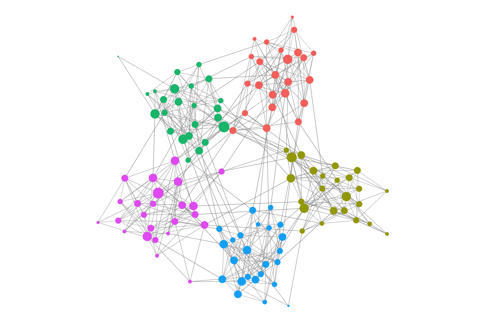

<!-- README.md is generated from README.Rmd. Please edit that file -->

# netkit

<!-- badges: start -->

[](https://github.com/agallinat/netkit/actions/workflows/R-CMD-check.yaml)
[](https://lifecycle.r-lib.org/articles/stages.html#experimental)
[](https://opensource.org/license/mit)
[](https://agallinat.github.io/netkit)
<!-- badges: end -->

<!-- Uncomment once the package is accepted on CRAN. Both badges render as
     "unknown" until then, which looks worse than no badge at all.
[](https://CRAN.R-project.org/package=netkit)
[](https://CRAN.R-project.org/package=netkit)
-->

**netkit** is an R toolkit for analyzing and visualizing networks:
global topology and per-node centrality, hubs and bottlenecks, community
structure and connectivity roles, signal diffusion from seed nodes, and
robustness under progressive node removal. It is built on
[igraph](https://igraph.org) and returns **ggplot2 objects rather than
drawing them**, so every diagnostic can be composed, themed, and dropped
straight into a figure.

It is domain-agnostic — anything you can express as nodes and edges.
Several of the worked examples lean on molecular interaction networks,
where seeding a diffusion with a gene list and asking which other genes
light up is a routine question, but nothing in the package assumes
biology.

<figure>

<figcaption aria-hidden="true">A 120-node network with five communities,
drawn by find_modules(); node size maps to degree.</figcaption>
</figure>

## What it does

- **Topology** — `summarize_graph_metrics()` for the graph as a whole
  and `node_metrics()` for its vertices (eleven centrality and position
  measures in one call), plus `plot_CCDF()` and `compare_networks()`.

- **Statistical testing** — `null_model()` builds degree-preserving
  random ensembles, and `metric_significance()` scores an observed
  metric against them, so “modularity 0.42” becomes a z-score and an
  empirical p-value rather than a bare number. `small_worldness()` is
  the classic application.

- **Node classification** — `find_hubs()`, `find_bottlenecks()`, and
  `calculate_roles()`, which implements the R1–R7 connectivity
  cartography of [Guimerà & Amaral,
  2005](https://www.nature.com/articles/nature03288).

- **Subnetwork extraction** — `extract_subnetwork()` turns a list of
  nodes you care about into a readable figure, by induced subgraph,
  neighborhood expansion, the union of shortest paths, an approximate
  Steiner tree, or diffusion-based expansion.

- **Information flow** — `network_diffusion()` and
  `network_diffusion_with_pvalues()`, the latter with a degree-matched
  permutation null, since diffusion scores are strongly
  degree-dependent. `greedy_seed_selection()` solves the inverse
  problem: given nodes you want to affect, which upstream nodes should
  you perturb?

- **Robustness** — `robustness_analysis()` simulates targeted and random
  node removal following [Albert et al.,
  2000](https://www.nature.com/articles/35019019).

- **Visualization** — `plot_Net()` and friends, with node/edge metadata
  mapping, dynamic sizing, and layout control. Most functions return a
  tabular result *and* a diagnostic plot, built for publication rather
  than for a quick look.

Analysis functions return a named list with a consistent vocabulary —
`plot`, `result`, `graph`, `method` — which is what lets them chain:

``` r
g <- node_metrics(g)$graph        # eleven metrics as vertex attributes
g <- find_hubs(g)$graph           # plus is_hub
g <- find_modules(g)$graph        # plus module
robustness_analysis(g, removal_strategy = "pagerank")
```

At the console those results print as a summary — what was computed, the
head of the table, and the shape of everything else — rather than as a
dump of the whole graph. The objects are still plain lists; `unclass()`
restores the default output.

## Edge weights

Every function that can use edge weights takes `weights` and a
`weight_type` declaring whether the values are a **strength**
(confidence scores, correlations — larger means more tightly connected)
or a **distance** (costs, dissimilarities — larger means further apart).
netkit ignores edge weights unless asked, and warns when a graph carries
a `weight` attribute it is ignoring.

That is deliberate, and differs from plain `igraph`, which reads the
attribute automatically while giving it *opposite* meanings in different
functions — a cost in `betweenness()` and `distances()`, a strength in
`cluster_louvain()`. See `vignette("weighted-networks")`.

## Installation

<!-- Uncomment once the package is accepted on CRAN.
Install the released version from CRAN:
&#10;```r
install.packages("netkit")
```
-->

Install the development version from GitHub:

``` r
# install.packages("remotes")
remotes::install_github("agallinat/netkit")
```

## Documentation

Full usage examples and tutorial are available in the package vignettes:

``` r
browseVignettes("netkit")
```

Or online:

- [Introduction to
  netkit](https://agallinat.github.io/netkit/articles/introduction.html)
- [Weighted networks: strength or
  distance?](https://agallinat.github.io/netkit/articles/weighted-networks.html)
- [Function reference](https://agallinat.github.io/netkit/reference/)

## Citation

If netkit is useful in work you publish, please cite it:

``` r
citation("netkit")
```

## Contributing

Contributions are welcome! If you’d like to report a bug, suggest a
feature, or improve documentation, please open an issue or submit a pull
request at:

<https://github.com/agallinat/netkit/issues>

For larger changes, feel free to open a discussion first.
